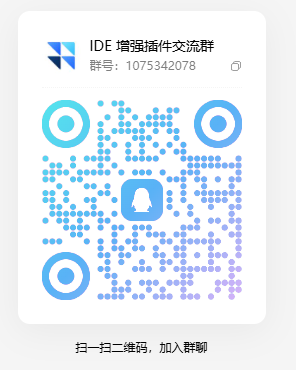

<div align="center">

# 🚀 BuddyRelay

### CodeBuddy CN 多账号管理与无感切号扩展

**开源 · 本地优先 · 无感切号 · 会话保留 · 额度守护 · 全自动签到与成长打捞**

[](https://github.com/soulvon/BuddyRelay/releases/latest)
[](LICENSE)
[]()
[](https://github.com/soulvon/BuddyRelay/releases)

[📥 下载安装](#-下载与安装) •
[⚡ 解决什么问题](#-它解决什么问题) •
[✨ 核心能力](#-核心能力) •
[🖥️ 平台适配](#-平台适配) •
[⚙️ 配置说明](#-配置说明) •
[❓ 常见问题 FAQ](#-常见问题-faq) •
[💬 社区交流与支持](#-社区交流与支持)

<br>

**无需频繁重新扫码，也无需在换号时中断正在进行的会话。**

BuddyRelay 是一款运行在 CodeBuddy CN 上的**多账号池管理与无感切换扩展**。它通过进程级会话更新与跨账号目录软链接映射，实现切号不关窗口、不重启编辑器、历史记录完全互通，并提供额度阈值守护、自动换号与成长体系全自动打捞。

</div>

---

## 📥 下载与安装

扩展包开箱即用，支持通过编辑器图形界面或命令行一键安装：

👉 **[下载 BuddyRelay 最新发布包（GitHub Releases）](https://github.com/soulvon/BuddyRelay/releases/latest)**

### 方式一：扩展面板安装（推荐）

1. 下载最新版 `buddy-relay-0.1.0.vsix`；
2. 打开 **CodeBuddy CN** 编辑器；
3. 进入左侧扩展面板（快捷键 `Ctrl+Shift+X` / macOS `Cmd+Shift+X`）；
4. 点击面板右上角 `...` 菜单 ➔ 选择 **“从 VSIX 安装...” (Install from VSIX...)**；
5. 选中下载的文件，安装完成后左侧活动栏即可看到 **BuddyRelay** 图标。

### 方式二：命令行安装

```bash
buddycn --install-extension buddy-relay-0.1.0.vsix --force
```

---

## ⚡ 它解决什么问题

| 你遇到的问题 | 默认情况 / 手动处理 | BuddyRelay 的处理方式 |
| :--- | :--- | :--- |
| **配额耗尽换号中断** | 官方换号需退出、关闭窗口、重启 IDE，当前长会话直接丢失 | **进程级热换号**：内存更新会话状态，无需重绘窗口，上下文完好保留 |
| **历史记录跨号隔离** | 会话按 UID 独立分目录存储，换号后无法查看上一个号的历史 | **目录软链接汇聚**：底层自动建立数据目录链接，历史会话跨号实时互通 |
| **额度何时耗尽未知** | 每次需手动打开网页后台查算力，写着写着突然撞上额度断点 | **实时双模看板**：状态栏与侧栏卡片直读实时算力余额，额度见底自动切号 |
| **多账号维护耗时费力** | 每天要挨个账号登录去签到、接单、领奖、派宠物打工 | **全自动流水线**：后台定时拟人化签到，全自动接单、出游打工、连登兑换 |
| **直播录屏泄露隐私** | 账号名称、邮箱与 UID 完整暴露在屏幕上 | **一键隐私脱敏**：敏感信息瞬间星号脱敏掩蔽，便于演示分享 |

---

## ✨ 核心能力

### 🔄 1. 无感切号与会话保留
- **平滑切号**：在侧栏卡片流或右下角状态栏一键选择账号，秒级切号生效；
- **跨平台目录链接**：Windows 采用免管理员权限的 NTFS Directory Junction，macOS/Linux 采用标准 POSIX 目录软链接（`ln -s`），历史会话零拷贝共享；
- **历史记录过滤穿透**：解除本地会话数据库中的账号强绑定限制，无论切换至哪个账号，历史记录完好无损。

### ⚡ 2. 额度监控与自动守护
- **配额直读对账**：穿透底层计量接口，精准查询基础体验包与活动赠送包的真实可用算力；
- **见底自动轮换**：当前账号算力低于设定阈值（默认 10%）或触发 429 限流时，自动无感切换至号池中剩余额度最多的健康账号；
- **智能防抖冷却**：设置 5 分钟冷却窗口与并发保护，杜绝多窗口频繁交叉切换。

### 📥 3. 多渠道账号导入
- **官方 OAuth 登录**：调起系统默认浏览器进入官方授权页，扫码或确认后自动入库；
- **Cockpit Tools 导入**：自动解密本机 `%USERPROFILE%\.antigravity_cockpit` 密文账号池，按 UID 去重快速迁移；
- **JSON 文本导入**：支持直接粘贴账号配置数据一键批量解析。

### 🎁 4. 成长中心全生命周期打捞
- **双源全量自动接单**：自动拆分桌面端与微信小程序专属源，一键为号池全员完成 20 项任务自动报名；
- **前置依赖自动自愈**：检测到新号未领养 Buddy 时自动执行领养协议，解开后续任务限制并到账初始奖励；
- **🐾 宠物出游打工**：空闲宠物全自动派遣前往咖啡馆打工，返航自动打捞打工礼包与 5~10 免费算力；
- **🔥 连登兑换与断登补救**：连签达标（7d/14d/28d）自动兑换大额积分礼包；当月断签自动使用补登卡补齐；
- **状态全景看板**：任务中心顶部直观展示宠物打工地点、返航倒计时、连签进度条与盲盒能量。

---

## 🖥️ 平台适配

| 平台 | 适配状态 | 底层链接实现 | 默认数据路径 |
| :--- | :--- | :--- | :--- |
| **🪟 Windows** | 完整支持 | NTFS Directory Junction | `%APPDATA%\CodeBuddy CN` |
| **🍏 macOS** | 完整支持 | POSIX Symlink (`ln -s`) | `~/Library/Application Support/CodeBuddy CN` |
| **🐧 Linux** | 完整支持 | POSIX Symlink (`ln -s`) | `~/.config/CodeBuddy CN` |

---

## ⚙️ 配置说明

可在 CodeBuddy 的 `settings.json` 中按需微调以下参数：

| 配置项 | 类型 | 默认值 | 说明 |
| :--- | :--- | :--- | :--- |
| `buddyRelay.autoCheckin.dailyTime` | `string` | `"00:10"` | 每日自动签到时间（HH:mm，24 小时制） |
| `buddyRelay.autoCheckin.randomJitterMinutes` | `number` | `30` | 随机抖动时间窗口（分钟），错开整点更像真人 |
| `buddyRelay.autoCheckin.perAccountDelaySeconds` | `number` | `15` | 多账号签到之间的随机间隔上限（秒） |
| `buddyRelay.autoSwitch.enabled` | `boolean` | `true` | 是否启用额度见底自动切号 |
| `buddyRelay.autoSwitch.quotaThresholdPercent` | `number` | `10` | 触发自动切号的剩余百分比阈值 |
| `buddyRelay.autoSwitch.strategy` | `string` | `"highest_quota"` | 切号策略：`highest_quota` / `lru` / `round_robin` |
| `buddyRelay.autoSwitch.cooldownMinutes` | `number` | `5` | 切号后的防抖冷却时长（分钟） |
| `buddyRelay.growthTasks.autoAfterCheckin` | `boolean` | `true` | 每日签到后是否自动执行成长中心流水线 |

---

## ❓ 常见问题 (FAQ)

<details>
<summary><b>Q1: 切换账号需要重启编辑器或重新打开窗口吗？</b></summary>
<br>
<b>不需要。</b>BuddyRelay 采用进程级会话更新机制，点击切换后即时生效，正在编辑的文件与正在进行的 AI 对话均不会丢失。
</details>

<details>
<summary><b>Q2: 为什么切换账号后能看到之前账号的历史记录？</b></summary>
<br>
因为扩展通过底层目录链接技术将不同 UID 的历史存储节点汇聚映射，同时穿透了客户端原本针对单 UID 的过滤限制，实现会话资产跨账号共享。
</details>

<details>
<summary><b>Q3: 插件是如何存储账号 Token 的？是否安全？</b></summary>
<br>
<b>完全安全。</b>账号凭据存储在 VS Code 原生隔离的 <code>globalState</code> 本地持久化数据库中，所有网络请求仅直连腾讯官方域名（<code>codebuddy.cn</code> / <code>copilot.tencent.com</code>），绝不向任何第三方服务器上传敏感数据。
</details>

<details>
<summary><b>Q4: 成长任务点击「一键完成」提示进行中是什么意思？</b></summary>
<br>
部分任务（如使用模板、和 AI 对话等）属于客户端行为任务，需在日常写代码时自然触发。脚本会自动完成接单与前置自愈，一旦你在使用中达成目标，脚本会自动打捞并兑付奖励。
</details>

---

## 🔒 隐私与安全性保障

- **100% 纯本地运行**：没有任何中心化后端服务器，无任何 telemetry 收集；
- **凭据本地隔离**：令牌均保存在本地磁盘受保护容器内；
- **代码完全开源**：透明接受社区审查，无任何后门与暗桩。

---

## 💬 社区交流与支持

如果 BuddyRelay 为你节省了重复切号与维护账号的精力，欢迎进群交流多账号管理与 CodeBuddy 的使用心得。

特别鸣谢 [Linux.do](https://linux.do) 社区各位佬友的大力支持与反馈！

<div align="center">

| 💬 QQ 交流群（1075342078） | ☕ 微信赞赏（请作者喝杯咖啡） |
| :---: | :---: |
|  |  |
| 验证信息请注明 "BuddyRelay" | 感谢你的支持与鼓励！ |

</div>

---

## 📄 开源许可证

本项目基于 [MIT License](LICENSE) 开源发布。
