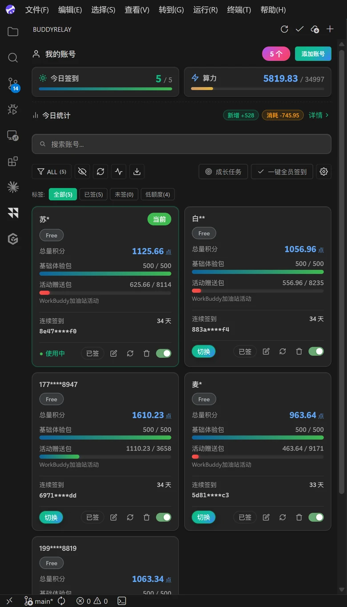
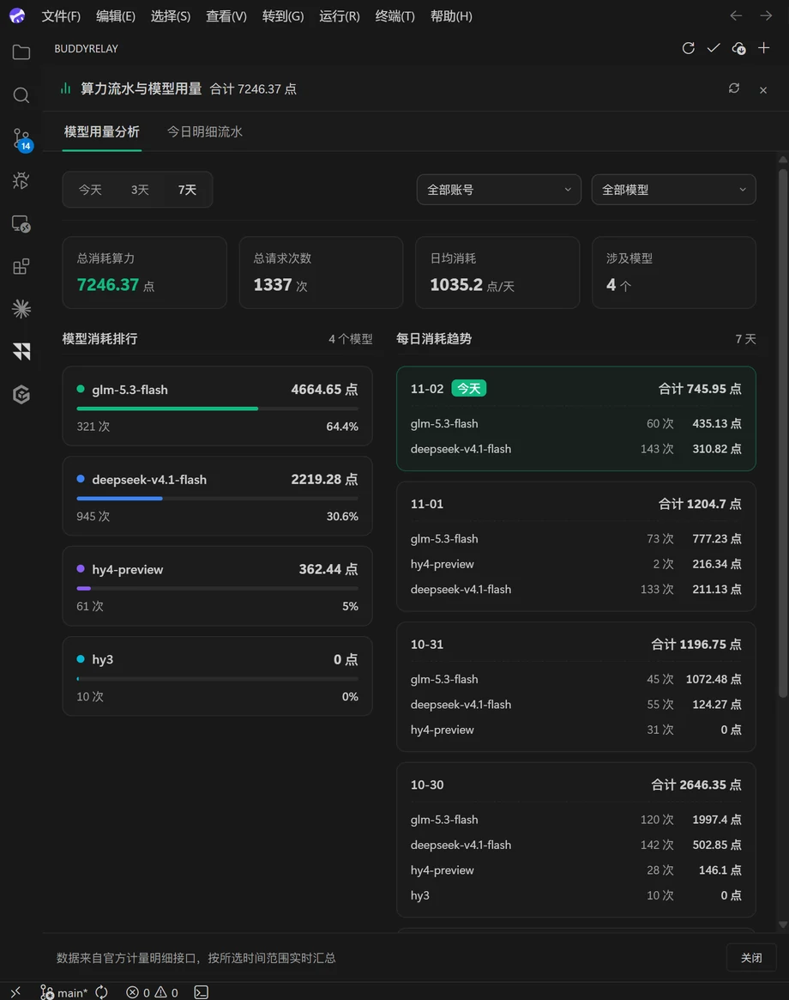
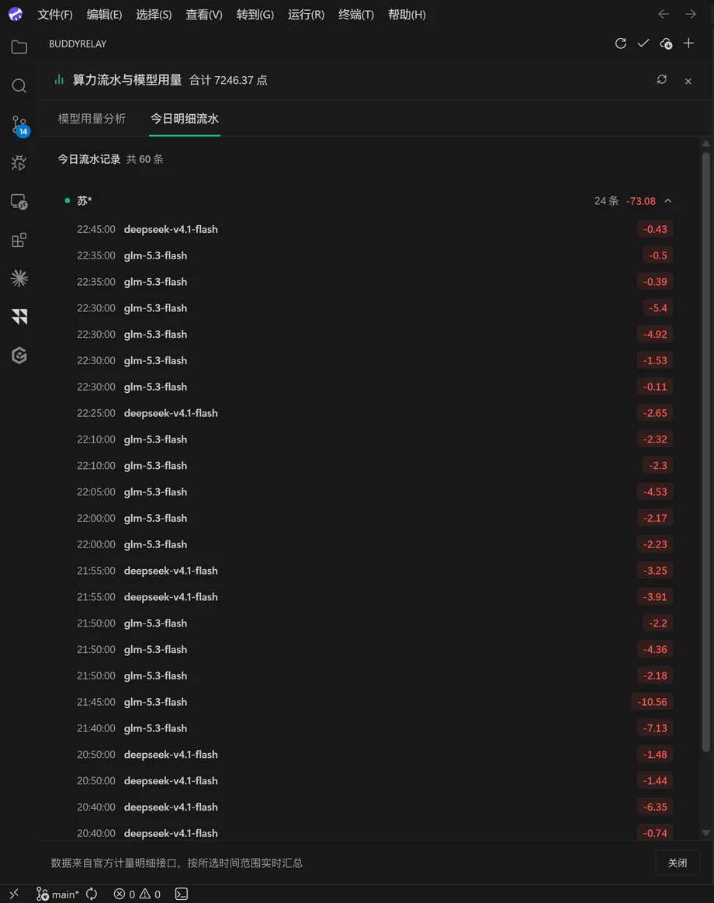
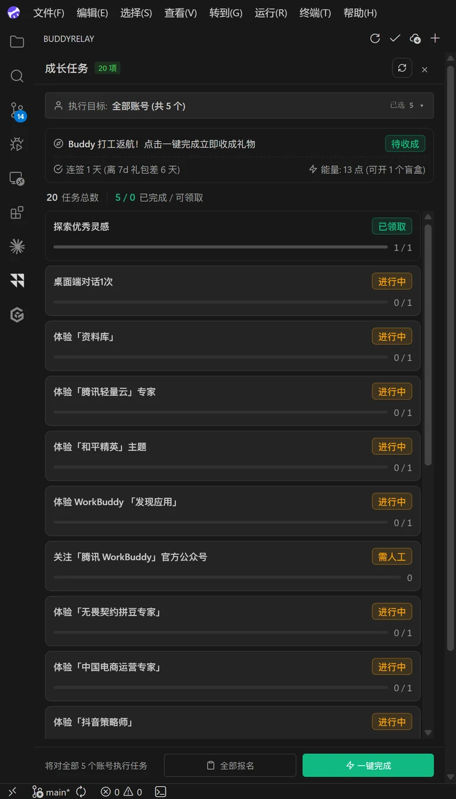
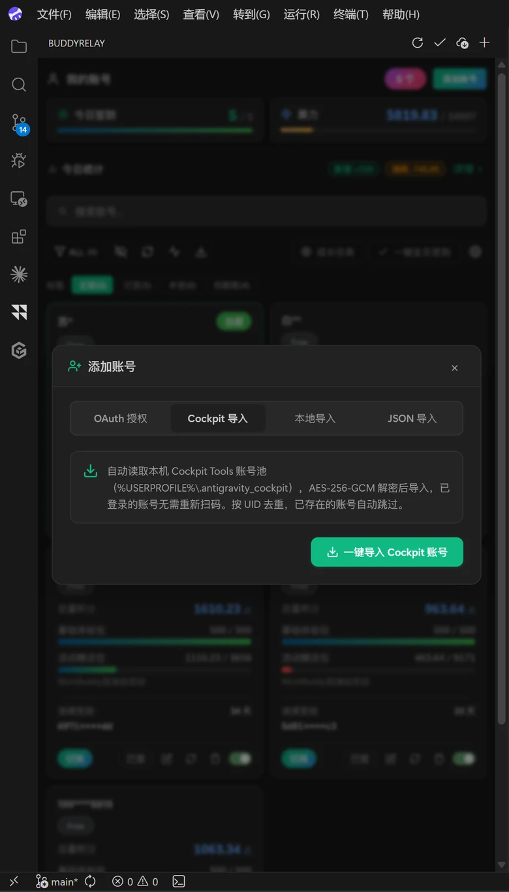
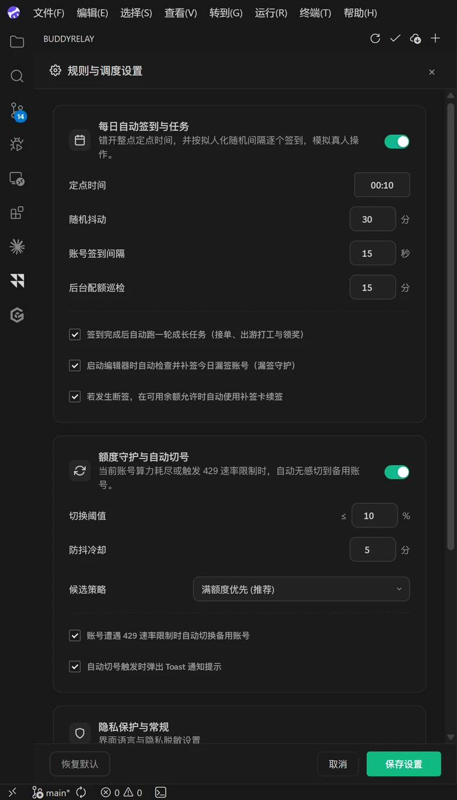
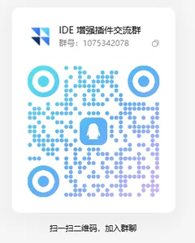

<div align="center">

# 🚀 BuddyRelay

### 电脑 CodeBuddy IDE 多账号管理与无感切号扩展
#### （仅运行于电脑桌面端 IDE · 深度打通腾讯 Buddy AI 生态 · 国内版全端账号与积分完全互通）

**切号不关窗口 · 不重启编辑器 · 历史会话完全互通 · 一键签到 · 一键做任务**

[](https://github.com/soulvon/BuddyRelay/releases/latest)
[](LICENSE)
[]()
[](https://github.com/soulvon/BuddyRelay/releases)
[](https://open-vsx.org/extension/soulvon/buddy-relay)
[](https://open-vsx.org/extension/soulvon/buddy-relay)

[English](README_en.md) • [简体中文](README.md)

**已上架 Open VSX 扩展市场：在电脑 CodeBuddy IDE 的扩展面板搜索 `BuddyRelay` 即可一键直装，后续版本由 IDE 自动更新。**

[📥 下载安装](#-下载与安装) •
[💡 家族各端辨析](#-搞清腾讯-buddy-家族各端新手必读) •
[🖼️ 界面预览](#️-界面预览) •
[📊 生态与支持矩阵](#-生态与版本支持矩阵) •
[⚡ 解决什么问题](#-它解决什么问题) •
[✨ 核心能力](#-核心能力) •
[🖥️ 平台适配](#-平台适配) •
[⚙️ 配置说明](#-配置说明) •
[❓ 常见问题 FAQ](#-常见问题-faq) •
[💬 社区交流与支持](#-社区交流与支持)

<br>

**无需频繁重新扫码，也无需在换号时中断正在进行的会话。**

BuddyRelay 是一款专为**电脑桌面端 CodeBuddy IDE**（国内版 CodeBuddy CN / 国际版 CodeBuddy）打造的多账号管理与无感切号扩展（`.vsix`）。通过进程级会话更新与跨账号目录软链接映射，实现**切号不关窗口、不重启编辑器、历史会话完全互通**，并提供**一键签到、一键做任务**、额度阈值守护与自动无感轮换。

> 💡 **核心须知（先看这两点）：**
> 1. **唯一运行宿主**：本扩展**必须且只能运行在电脑桌面端的 CodeBuddy IDE 编辑器中**（Windows / macOS / Linux）。WorkBuddy 桌面客户端、WorkBuddy 手机 App、微信小程序以及 CodeBuddy CLI 命令行均无 VS Code 扩展系统，无法直接安装 `.vsix` 插件！
> 2. **国内全端积分共享**：腾讯国内版（CodeBuddy CN、WorkBuddy 桌面端、手机 App、微信小程序）底层全部绑定同一个手机号。在电脑 IDE 中通过本插件代领的签到奖励和任务积分，全端 100% 共享互通！

</div>

---

## 📥 下载与安装

BuddyRelay 已正式上架 **Open VSX 扩展市场**（CodeBuddy IDE 内置扩展商店的底层市场），**在电脑 CodeBuddy IDE 里直接搜索扩展名即可一键安装，无需下载任何文件**。

👉 **商店主页**：[open-vsx.org/extension/soulvon/buddy-relay](https://open-vsx.org/extension/soulvon/buddy-relay)

### 方式一：扩展商店直接安装（最推荐，最快）

1. 打开电脑上的 **CodeBuddy CN**（或 CodeBuddy 国际版）IDE；
2. 进入左侧扩展面板（快捷键 `Ctrl+Shift+X` / macOS `Cmd+Shift+X`）；
3. 在搜索框输入 **`BuddyRelay`** 或扩展 ID **`soulvon.buddy-relay`**；
4. 点击 **安装**，几秒后左侧活动栏即可看到 **BuddyRelay** 图标。

> 💡 商店安装的最大好处：**后续新版本由 IDE 自动检测更新**，不用每次手动下载 VSIX 重装。

### 方式二：从 VSIX 离线安装（网络受限或需锁定旧版本时）

1. 下载最新版 `buddy-relay-1.2.10.vsix`（[GitHub Releases](https://github.com/soulvon/BuddyRelay/releases/latest)）；
2. 打开电脑上的 **CodeBuddy CN**（或 CodeBuddy 国际版）IDE；
3. 进入左侧扩展面板 ➔ 点击右上角 `...` 菜单 ➔ 选择 **“从 VSIX 安装...” (Install from VSIX...)**；
4. 选中下载的文件，安装完成后左侧活动栏即可看到 **BuddyRelay** 图标。

### 方式三：命令行安装

```bash
# 从扩展市场直接安装（推荐）
buddycn --install-extension soulvon.buddy-relay --force

# 或从本地 VSIX 文件安装
buddycn --install-extension buddy-relay-1.2.10.vsix --force
```

> ⚠️ **新手避坑（重要）：**  
> **本插件必须安装在电脑桌面端 CodeBuddy IDE 内！**  
> - ❌ **无法安装插件的客户端**：WorkBuddy 桌面端、WorkBuddy 手机 App、WorkBuddy 微信小程序、CodeBuddy CLI 命令行工具（这些都不是 IDE，没有扩展商店与安装面板）。  
> - ✅ **适用场景**：只要你在**电脑 CodeBuddy IDE** 里写代码，直接搜索安装本扩展即可切号、自动签到、自动做任务。  
> - 💡 **纯 WorkBuddy 用户怎么用？** 如果你平时只用 WorkBuddy（桌面端 / 手机 App / 微信小程序）办公：切号请使用独立桌面工具 **Cockpit Tools**；或者在电脑上装一个 CodeBuddy CN 挂着本插件自动签到/做任务，攒下的积分你的手机 App、微信小程序和桌面端都能直接用！

---

## 💡 搞清腾讯 Buddy 家族各端：新手必读

腾讯围绕“Buddy AI”推出了一整套横跨**电脑 IDE、CLI 命令行、独立桌面办公、手机移动端、微信小程序**的庞大产品矩阵。初学者极易混淆，请对照下表理清全貌：

| 客户端 / 端形态 | 运行平台 | 产品类型与核心场景 | 账号与积分归属 | BuddyRelay 适用性 |
| :--- | :--- | :--- | :--- | :--- |
| **电脑 CodeBuddy CN** (国内版) | **电脑桌面端**<br>(Win / Mac / Linux) | **AI 编程 IDE**<br>(基于 VS Code 定制，带扩展面板与侧栏) | **【国内账号池】** 手机号/微信/腾讯云登录。<br>与 WorkBuddy 国内全端**账号与积分完全互通**。 | 🎯 **唯一原生宿主 (100% 完美支持)**<br>切号不关窗口、历史互通、一键签到做任务 |
| **电脑 CodeBuddy** (国际版) | **电脑桌面端**<br>(Win / Mac / Linux) | **AI 编程 IDE**<br>(基于 VS Code 定制，带扩展面板) | **【国际账号池】** 邮箱/GitHub 登录。<br>与国际版 WorkBuddy AI 互通，**与国内完全隔离**。 | 🎯 **原生宿主 (完整支持切号与会话)**<br>注：采用 **4 档位模型选择**；官方无签到活动 |
| **CodeBuddy CLI** (CodeBuddy Code) | **电脑终端**<br>(Shell / Terminal) | **命令行 AI 编程工具**<br>(面向 DevOps/资深工程师，自然语言跑终端) | 启动时选国内/国际站，支持 OAuth 登录 | ➖ **纯命令行程序，无扩展系统**<br>无需安装也无法加载 `.vsix` 扩展 |
| **WorkBuddy 桌面端** (国内版) | **电脑桌面端**<br>(Win / Mac) | **独立职场 Agent 工作台**<br>(做 PPT、文档处理、网页自动化、执行 Skills) | **【国内账号池】** 手机号登录。<br>与 CodeBuddy CN 共享同一手机号积分。 | ❌ **独立办公软件，非 IDE**<br>不能装插件；切号建议用独立工具 **Cockpit Tools** |
| **WorkBuddy AI 桌面端** (国际版) | **电脑桌面端**<br>(Win / Mac) | **独立职场 Agent 工作台**<br>(海外 Agent 自动化，支持 MCP 协议与海外模型) | **【国际账号池】** 邮箱/GitHub 登录。<br>与 CodeBuddy 国际版互通，**与国内完全隔离**。 | ❌ **独立办公软件，非 IDE**<br>不能装插件；切号请使用独立桌面工具 |
| **WorkBuddy 手机 App** (iOS / Android) | **移动端手机** | **移动职场助手**<br>(随时随地发指令、看 Agent 进度、语音输入) | **【国内账号池】** 手机号/微信登录。<br>同属国内统一积分池。 | ❌ **手机应用，无扩展系统**<br>但积分与电脑端 100% 互通共享 |
| **WorkBuddy 微信小程序** | **微信移动端** | **轻量随身智能体**<br>(微信内免安装即用，快捷问答与简单任务) | **【国内账号池】** 微信一键绑定。<br>同属国内统一积分池。 | ❌ **微信小程序，无扩展系统**<br>但积分与电脑端 100% 互通共享 |

### 五大核心认知：
1. **铁律一：BuddyRelay 唯一宿主是电脑 CodeBuddy IDE**  
   本扩展是 `.vsix` 文件，只能安装在电脑端的 CodeBuddy IDE（国内版或国际版）中。手机 App、小程序、CLI 命令行和 WorkBuddy 桌面端都无法安装插件。
2. **铁律二：国内版 4 端积分 100% 互通（羊毛通吃）**  
   电脑 CodeBuddy CN、电脑 WorkBuddy 桌面端、WorkBuddy 手机 App、WorkBuddy 微信小程序，底层认的是**同一个手机号**。在电脑 IDE 里用 BuddyRelay 挂着每天自动签到、出游打工做任务攒下的积分，你掏出手机打开 App 或小程序，积分都在同一个钱包里，全端通吃！
3. **铁律三：CodeBuddy CLI 是免图形界面的终端独立工具**  
   CLI 是在终端中直接运行的命令，服务于无头服务器或纯终端开发，没有图形界面与插件生态，切号通常走命令行配置或环境变量。
4. **铁律四：国内版与国际版完全物理隔离**  
   国内版（`.cn` / 手机号）和国际版（`.ai` / 邮箱 / GitHub）账号不同、积分不同、模型池不同、活动不同，严禁混淆。
5. **铁律五：国际版 CodeBuddy 的 4 档位模型机制**  
   CodeBuddy 国际版采用 **4 档位模型选择机制**（由后台路由，不支持手动选具体模型名），与国内版可指定具体模型的交互略有差异。

---

## 🖼️ 界面预览

全图形化沉浸操作，涵盖**多账号卡片流**、**算力流水与模型用量分析**、**全自动任务中心**、**多源便捷导入**与**智能调度设置**：

### 1. 账号管理卡片流与配额仪表盘
> 核心特性：**切号不关窗口 · 不重启编辑器 · 历史会话完全互通**  
> 支持两列卡片流排版、一键隐私脱敏、当前账号状态开关、算力余额精准双包对账与低额度智能告警。

<div align="center">
  
</div>

---

### 2. 算力流水与多维模型用量分析看板
> 核心特性：**穿透官方计量明细接口 · 7 天多维趋势 · 模型用量排行**  
> 实时统计总消耗算力、请求总次数、日均消耗与涉及模型；直观呈现各模型用量占比（GLM / DeepSeek / 混元等）与每日消耗趋势柱状图。

<div align="center">
  
</div>

---

### 3. 今日明细流水精准追溯
> 核心特性：**按账号折叠聚合 · 毫秒级时间戳 · 单次调用精确扣费记录**  
> 实时抓取当日所有对话与补全请求，详细列出每次调用的模型、精确扣减算力与时间，账目清清楚楚。

<div align="center">
  
</div>

---

### 4. 全生命周期成长体系自动化
> 核心特性：**一键签到 · 一键做任务**  
> 任务中心直观展示宠物打工返航倒计时、连签进度条、盲盒能量与 20 项官方成长任务；支持全账号一键报名接单与达标奖励自动打捞。

<div align="center">
  
</div>

---

### 5. 多源便捷账号导入
> 支持官方 OAuth 网页/扫码登录、**Cockpit Tools 本地 AES-256-GCM 密文池一键迁移**、本地已登录会话直读与 JSON 批量导入。

<div align="center">
  
</div>

---

### 6. 规则与智能调度设置
> 核心特性：**定点拟人签到 · 429 速率限制自动无感切号 · 满额度优先策略**  
> 支持自定义定时签到时间与随机抖动窗口、成长任务联动执行、额度耗尽或遭遇 429 速率限制时自动平滑切至备用账号。

<div align="center">
  
</div>

---

## 📊 生态与版本支持矩阵

BuddyRelay 针对腾讯生态内的不同分支版本进行了严格区分与适配：

| 矩阵维度 / 功能特性 | CodeBuddy CN (国内版 IDE) | CodeBuddy (国际版 IDE) | WorkBuddy (国内版客户端) | WorkBuddy AI (国际版客户端) |
| :--- | :---: | :---: | :---: | :---: |
| **产品基础形态** | AI 编程 IDE | AI 编程 IDE | 独立桌面 Agent 工作台 | 独立桌面 Agent 工作台 |
| **BuddyRelay 插件安装宿主 (.vsix)** | ✅ 原生完整支持 | ✅ 原生完整支持 | ❌ 独立软件，无扩展系统 | ❌ 独立软件，无扩展系统 |
| **切号不关窗口、不重启** | ✅ 内存热更无感生效 | ✅ 内存热更无感生效 | ➖ 需用独立桌面工具 (如 Cockpit) | ➖ 需用独立桌面工具 |
| **账号池与算力积分通用性** | 国内账号池（手机号） | 国际账号池（邮箱/GitHub） | 与 CodeBuddy CN 积分完全共享 | 与 CodeBuddy 国际版完全共享 |
| **一键签到 (定点拟人化调度)** | ✅ 完整支持（每日到账） | ➖ 官方国际版未上线该活动 | ✅ 签到积分两端通算共享 | ➖ 官方国际版未上线该活动 |
| **一键做任务 (全自动接单与打捞)** | ✅ 完整支持（自动打捞） | ➖ 官方国际版未上线该活动 | ✅ 任务奖励两端通算共享 | ➖ 官方国际版未上线该活动 |
| **历史会话完全互通 (零拷贝穿透)** | ✅ 软链接穿透 | ✅ 软链接穿透 | ➖ 独立工作台机制不同 | ➖ 独立工作台机制不同 |
| **额度实时监控与自动切号** | ✅ 完整支持 | ✅ 完整支持 | ➖ 仅在 IDE 宿主内生效 | ➖ 仅在 IDE 宿主内生效 |
| **Cockpit / JSON 多源导入** | ✅ 完整支持 | ✅ 完整支持 | ✅ 账号池跨端通用 | ✅ 账号池跨端通用 |
| **模型选择机制** | 自由选择具体模型 | 4 档位模型选择（后台路由） | 自由选择具体模型 | 自由选择具体模型 |

---

## ⚡ 它解决什么问题

| 你遇到的问题 | 默认情况 / 手动处理 | BuddyRelay 的处理方式 |
| :--- | :--- | :--- |
| **配额耗尽换号中断** | 官方换号需退出、关闭窗口、重启 IDE，当前长会话直接丢失 | **切号不关窗口、不重启编辑器**：内存更新会话状态，无需重绘窗口，上下文完好保留 |
| **历史记录跨号隔离** | 会话按 UID 独立分目录存储，换号后无法查看上一个号的历史 | **历史会话完全互通**：底层自动建立数据目录链接，历史会话跨号实时零拷贝互通 |
| **日常重复人工维护** | 每天要挨个账号登录去签到、接单、领奖、派宠物打工 | **一键签到、一键做任务**：后台定时拟人化签到，全自动接单、出游打工、连登兑换 |
| **额度何时耗尽未知** | 每次需手动打开网页后台查算力，写着写着突然撞上额度断点 | **实时双模看板**：状态栏与侧栏卡片直读实时算力余额，额度见底自动切号 |
| **手动发版更新繁琐** | 每次出新版本都要重新手动去网页翻找下载 | **自动更新检查**：后台静默检测 GitHub Release，弹窗一键下载安装并重载 |
| **直播录屏泄露隐私** | 账号名称、邮箱与 UID 完整暴露在屏幕上 | **全链路隐私脱敏**：侧栏、状态栏与切号菜单敏感信息瞬间星号脱敏掩蔽 |

---

## ✨ 核心能力

### 🔄 1. 无感切号与会话保留
- **平滑切号**：在侧栏卡片流或右下角状态栏一键选择账号，**切号不关窗口、不重启编辑器**，即时生效；
- **切换回执确认**：每条切号指令均由宿主写回执确认（Patch v5 回执闭环），成功才报成功，失败给出宿主侧真实原因，杜绝"假切换"；
- **跨平台目录链接**：Windows 采用免管理员权限的 NTFS Directory Junction，macOS/Linux 采用标准 POSIX 目录软链接（`ln -s`），**历史会话完全互通**；
- **历史记录过滤穿透**：解除本地会话数据库中的账号强绑定限制，无论切换至哪个账号，历史记录完好无损。

### 🪟 2. 多窗口同步与账号互斥
- **号池跨窗口实时同步**：账号池落盘于共享号池文件（`%APPDATA%\CodeBuddy CN\buddy-relay\pool.json`），任一窗口导入/删除/切号，其余窗口免重启实时跟随；
- **跨窗口账号锁**：每个窗口为当前账号持心跳锁，卡片直观标注"他窗占用"，崩溃残留锁自动清理；
- **自动切号防抢号**：自动轮换候选自动排除其他窗口正持有的账号，杜绝双窗口抢号横跳。

### ⚡ 3. 额度监控与自动守护（探针预检 + 频率熔断）
- **配额直读对账**：穿透底层计量接口，精准查询基础体验包与活动赠送包的真实可用算力；
- **候选探针预检**：自动切号前打入轻量健康度探针，自动识别并跳过已失效或在冷却中的账号；
- **切号频率熔断保护**：60 秒内切号超过 5 次自动触发熔断冷却，防止号池大面积受限时陷入死循环；
- **智能防抖冷却**：设置自定义冷却窗口与并发保护，杜绝多窗口频繁交叉切换。

### 📥 4. 账号资产出入闭环与分组管理
- **号池备份与导出**：支持一键导出为标准 JSON 备份，提供「完整凭证模式」与「脱敏安全模式」；
- **单号凭证提取**：卡片一键复制 AccessToken 密钥，方便外部脚本挂载与凭证流转；
- **失效号原地重授**：Token 过期账号提供原地唤起浏览器 OAuth 重新授权，凭证原地刷新自愈，无需删号重录；
- **自定义业务标签 (Tags)**：支持自定义标签（如主力/挂机/出海），顶部标签栏动态提取并支持一键多维筛选；
- **卡片备注备忘 (Notes)**：支持为每个账号记录独立备注说明，一目了然；
- **多渠道导入**：官方 OAuth、Cockpit Tools 密文解密导入与 JSON 文本/文件导入。

### 📋 5. 算力流水对账与事件审计
- **快照差值测算 (Delta Snapshot)**：周期对账精准捕获会话与代码补全的真实算力净消耗；
- **全生命周期审计**：详细记录每日定时签到到账、宠物出游打工到账、手动切号与自动切号事件；
- **侧栏今日流水面板**：侧栏底部常驻展开收起流水抽屉，今日新增、净消耗与切号明细清晰可视。

### 🎁 6. 每日任务自动化（一键签到 · 一键做任务）
- **一键签到**：支持每日定点自动签到（带随机抖动与拟人化账号间隔），杜绝断签；
- **一键做任务**：自动双源任务接单、前置依赖自动自愈、宠物出游打工、连登礼包兑换与达标奖励自动打捞；
- **状态全景看板**：任务中心顶部直观展示宠物打工地点、出游倒计时、连签进度条与盲盒能量。

### 🔄 7. 自动检查与一键更新
- **GitHub 自动检测**：扩展启动后静默比对 GitHub Releases 最新版本号；
- **更新日志智能摘要**：弹窗直接展示本次发布的核心更新要点，支持在编辑器内以 Markdown 预览完整更新说明；
- **多维操作选项**：提供「立即更新」、「查看完整日志」、「仅下载安装包」等灵活操作；
- **手动检查命令**：设置面板提供常驻版本号展示与「检查更新」快捷按钮。

---

## 🖥️ 平台适配

| 平台 | 适配状态 | 底层链接实现 | 默认数据路径 |
| :--- | :--- | :--- | :--- |
| **🪟 Windows** | 完整支持 | NTFS Directory Junction | `%APPDATA%\CodeBuddy CN` |
| **🍏 macOS** | 完整支持 | POSIX Symlink (`ln -s`) | `~/Library/Application Support/CodeBuddy CN` |
| **🐧 Linux** | 完整支持 | POSIX Symlink (`ln -s`) | `~/.config/CodeBuddy CN` |

---

## ⚙️ 配置说明

可在 CodeBuddy 的 `settings.json` 中按需微调以下参数：

| 配置项 | 类型 | 默认值 | 说明 |
| :--- | :--- | :--- | :--- |
| `buddyRelay.autoCheckin.dailyTime` | `string` | `"00:10"` | 每日自动签到时间（HH:mm，24 小时制） |
| `buddyRelay.autoCheckin.randomJitterMinutes` | `number` | `30` | 随机抖动时间窗口（分钟），错开整点更像真人 |
| `buddyRelay.autoCheckin.perAccountDelaySeconds` | `number` | `15` | 多账号签到之间的随机间隔上限（秒） |
| `buddyRelay.autoSwitch.enabled` | `boolean` | `true` | 是否启用额度见底自动切号 |
| `buddyRelay.autoSwitch.quotaThresholdPercent` | `number` | `10` | 触发自动切号的剩余百分比阈值 |
| `buddyRelay.autoSwitch.strategy` | `string` | `"highest_quota"` | 切号策略：`highest_quota` / `lru` / `round_robin` |
| `buddyRelay.autoSwitch.cooldownMinutes` | `number` | `5` | 切号后的防抖冷却时长（分钟） |
| `buddyRelay.growthTasks.autoAfterCheckin` | `boolean` | `true` | 每日签到后是否自动执行成长中心流水线 |
| `buddyRelay.update.autoCheck` | `boolean` | `true` | 启动时是否自动检查 GitHub 最新发布版本 |
| `buddyRelay.update.autoInstall` | `boolean` | `false` | 发现新版本时是否自动静默安装（无需二次确认） |

---

## ❓ 常见问题 (FAQ)

<details>
<summary><b>Q1: 切换账号需要重启编辑器或重新打开窗口吗？</b></summary>
<br>
<b>不需要。</b>BuddyRelay 采用进程级会话更新机制，点击切换后即时生效，正在编辑的文件与正在进行的 AI 对话均不会丢失，做到<b>切号不关窗口、不重启编辑器</b>。
</details>

<details>
<summary><b>Q2: 为什么切换账号后能看到之前账号的历史记录？</b></summary>
<br>
因为扩展通过底层目录链接技术将不同 UID 的历史存储节点汇聚映射，同时穿透了客户端原本针对单 UID 的过滤限制，实现<b>历史会话完全互通</b>。
</details>

<details>
<summary><b>Q3: 国际版（CodeBuddy AI / WorkBuddy AI）支持签到和成长任务吗？</b></summary>
<br>
国际版完整支持多账号号池管理、无感切号、会话保留与额度监控。但由于腾讯官方仅在境内国内版上线了签到积分与 Buddy 加油站活动，因此国际版账号不参与签到和成长中心任务。
</details>

<details>
<summary><b>Q4: 插件是如何存储账号 Token 的？是否安全？</b></summary>
<br>
<b>完全安全。</b>账号凭据存储在 VS Code 原生隔离的 <code>globalState</code> 本地持久化数据库中，所有网络请求仅直连腾讯官方域名（<code>codebuddy.cn</code> / <code>copilot.tencent.com</code>），绝不向任何第三方服务器上传敏感数据。
</details>

<details>
<summary><b>Q5: 成长任务点击「一键完成」提示进行中是什么意思？</b></summary>
<br>
部分任务（如使用模板、和 AI 对话等）属于客户端行为任务，需在日常写代码时自然触发。脚本会自动完成接单与前置自愈，一旦你在使用中达成目标，脚本会自动打捞并兑付奖励。
</details>

<details>
<summary><b>Q6: 我平时只用 WorkBuddy 桌面端办公不写代码，能用这个插件切号吗？</b></summary>
<br>
<b>不能直接在 WorkBuddy 里安装。</b>BuddyRelay 是专门为 CodeBuddy IDE 打造的 <code>.vsix</code> 扩展，WorkBuddy 桌面客户端没有插件安装面板。<br>
<b>但你可以这样搭配使用：</b>
<ol>
  <li><b>在客户端切号</b>：如果你需要在 WorkBuddy 桌面客户端独立切号，建议使用外部独立桌面工具 <b>Cockpit Tools</b>（通过直接读写持久化凭据实现外部切号）；</li>
  <li><b>共享白嫖算力</b>：国内版 WorkBuddy 与 CodeBuddy CN 的账号与积分是完全互通的。你可以在电脑上装一个 CodeBuddy CN 挂着本插件，让它每天自动签到、做任务、派宠物打工赚积分。你在 WorkBuddy 桌面端打开时，就能直接消耗这些免费额度！</li>
</ol>
</details>

<details>
<summary><b>Q7: CodeBuddy 国际版的模型选择机制是怎样的？</b></summary>
<br>
CodeBuddy 国际版采用官方的 <b>4 档位模型选择机制</b>（按推理强度与响应速度分为 4 个档级），由平台后端根据档位动态路由模型，不支持手动单选具体模型名。国际版账号在 BuddyRelay 中同样支持无感切号与号池管理，但请注意国际版账号与国内版完全隔离，且官方暂未开放签到/成长活动。
</details>

<details>
<summary><b>Q8: WorkBuddy 手机 App、微信小程序以及 CodeBuddy CLI 能用这个插件吗？</b></summary>
<br>
<b>均无法直接安装插件，但国内端算力积分 100% 共享：</b>
<ul>
  <li><b>手机 App 与微信小程序</b>：移动端和微信没有 VS Code 扩展运行环境，<b>无法安装 <code>.vsix</code> 插件</b>。但因为它们与 CodeBuddy CN 绑定的是同一个手机号，你在电脑 CodeBuddy IDE 里通过 BuddyRelay 挂机领取的签到算力与打工任务积分，掏出手机在 App 或小程序里可以直接消耗使用！</li>
  <li><b>CodeBuddy CLI (命令行)</b>：CLI 是纯终端轻量化工具（<code>buddy</code> 命令），用于终端自动化开发，本身无图形界面与插件系统，不需要也无法加载 <code>.vsix</code> 插件。</li>
</ul>
</details>

---

## 🔒 隐私与安全性保障

- **100% 纯本地运行**：没有任何中心化后端服务器，无任何 telemetry 收集；
- **凭据本地隔离**：令牌均保存在本地磁盘受保护容器内；
- **代码完全开源**：透明接受社区审查，无任何后门与暗桩。

---

## 💬 社区交流与支持

如果 BuddyRelay 为你节省了重复切号与维护账号的精力，欢迎进群交流多账号管理与 CodeBuddy 的使用心得。

<div align="center">

| 💬 QQ 交流群（1075342078） | ☕ 微信赞赏（请作者喝杯咖啡） |
| :---: | :---: |
|  |  |
| 验证信息请注明 "BuddyRelay" | 感谢你的支持与鼓励！ |

</div>

---

## 🧰 同系列作品（同一作者的 AI 工具箱）

| 项目 | 简介 | 适合谁 |
| :--- | :--- | :--- |
| [🚀 **AnyBridge**](https://github.com/soulvon/AnyBridge)  | BYOK 模型接入工作台：统一管理 16+ AI 编程智能体（Cursor / Windsurf / Devin / Claude Code / Codex / CodeBuddy 等）的模型渠道，本地代理接管 + 配置直写，支持第三方中转站与本地聚合网关 | 想给封闭 IDE 接自定义模型的人 |
| [🪁 **Kite**](https://github.com/soulvon/Kite)  | Windsurf / Devin 多账号号池与 AI IDE 增强套件：多账号共享号池、额度监控、额度耗尽自动切换、多实例分身、界面增强 | Windsurf / Devin 重度用户 |
| [🛸 **Antigravity-Kite**](https://github.com/soulvon/Antigravity-Kite)  | Antigravity 多账号无感切号与号池管理：Claude / Gemini 双模型双窗口官方配额（5h+Weekly 带重置倒计时）、安全声明自动确认、Gemini 凭证同步、中英双语自适应 | Antigravity IDE 用户 |
| [🔍 **devin-search-mcp**](https://github.com/soulvon/devin-search-mcp)  | 把 Devin 原生全网实时搜索与网页正文提取抽成标准 MCP：1 秒级响应、零模型额度消耗，`npx -y devin-search-mcp` 直装 | Cursor / Claude Code / Claude Desktop 用户 |

> 全部开源 · 本地优先 · 持续维护 —— 前往 [作者主页](https://github.com/soulvon) 查看全部项目。

---

---

## ⭐ Star History

**如果这个工具帮到了你，点一个 Star 让更多开发者看到它 · If this project helps you, a star means a lot.**

[](https://star-history.com/#soulvon/soulvon/BuddyRelay&Date)

---

## 📄 开源许可证

本项目基于 [MIT License](LICENSE) 开源发布。
