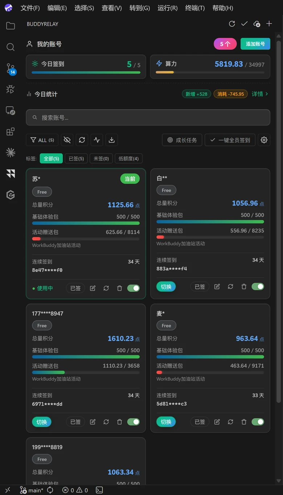
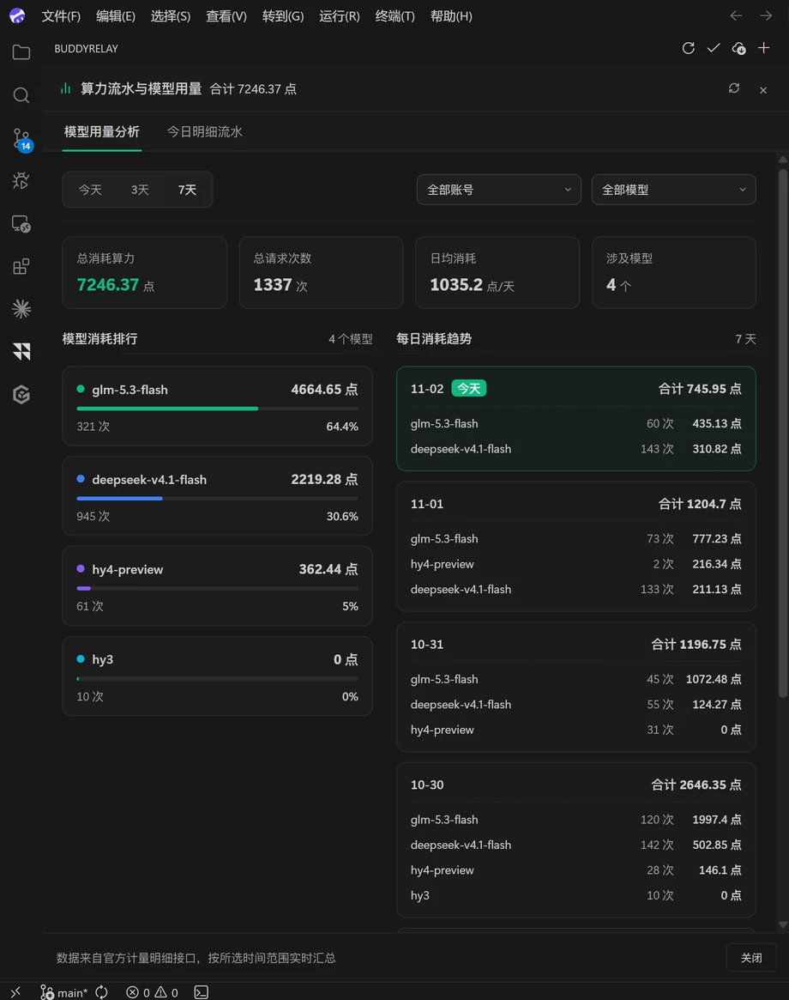
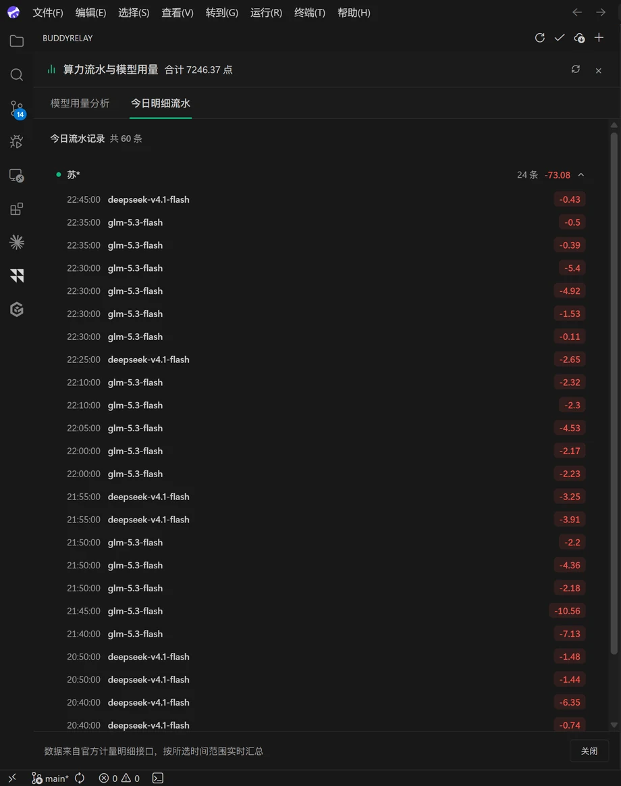
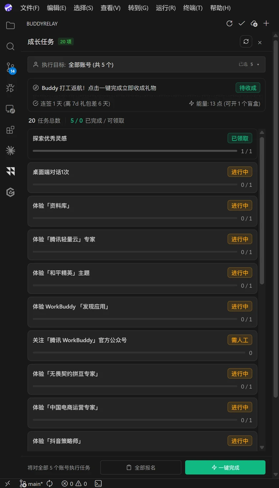
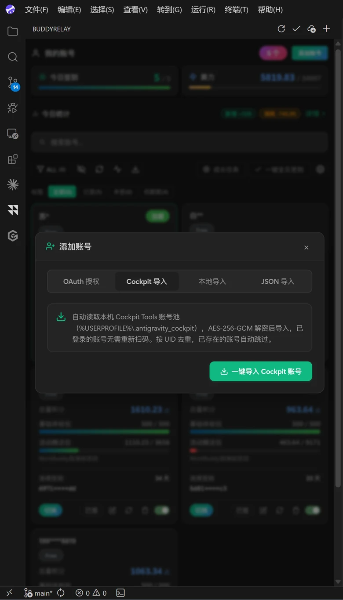
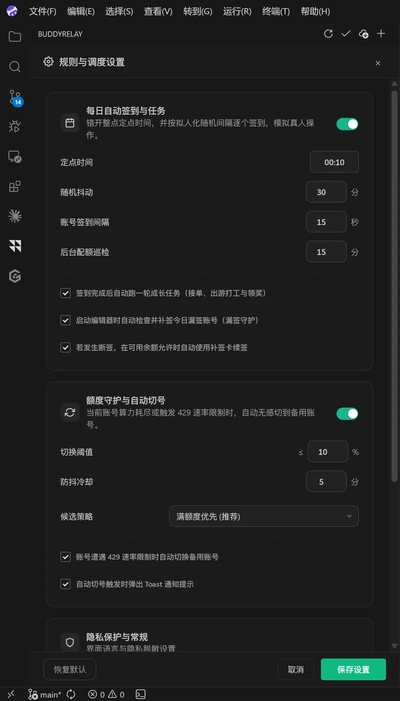
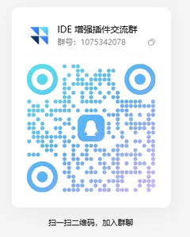

<div align="center">

# 🚀 BuddyRelay

### Seamless multi-account switching & account pool management for CodeBuddy Desktop IDE
#### (Runs exclusively on Desktop CodeBuddy IDE · Full compatibility with Tencent Buddy AI ecosystem · 100% shared credits across all domestic clients)

**Switch without restart · No editor reload · Full session history intact · One-click check-in · One-click tasks**

[](https://github.com/soulvon/BuddyRelay/releases/latest)
[](LICENSE)
[]()
[](https://github.com/soulvon/BuddyRelay/releases)
[](https://open-vsx.org/extension/soulvon/buddy-relay)
[](https://open-vsx.org/extension/soulvon/buddy-relay)

[English](README_en.md) • [简体中文](README.md)

**Now live on the Open VSX Registry: search `BuddyRelay` in your Desktop CodeBuddy IDE extension panel to install in one click — future updates roll in automatically.**

[📥 Install](#-install) •
[💡 Family Ecosystem Guide](#-understanding-the-tencent-buddy-family-must-read) •
[🖼️ Preview](#️-preview) •
[📊 Support matrix](#-support-matrix) •
[⚡ What it solves](#-what-it-solves) •
[✨ Core features](#-core-features) •
[⚙️ Settings](#️-settings) •
[❓ FAQ](#-faq) •
[💬 Community](#-community--support)

<br>

**No repeated QR scans, no interrupted conversations when switching accounts.**

BuddyRelay is a multi-account management extension (`.vsix`) specifically designed for **Desktop CodeBuddy IDE** (CodeBuddy CN & CodeBuddy International). With in-process session updates and cross-account directory junction mapping, you get **account switching without closing windows or restarting the editor — with full session history intact** — plus one-click check-in, automated growth tasks, quota guarding and seamless auto-rotation.

> 💡 **Core Points (Read First):**
> 1. **Exclusive Host**: This extension **runs exclusively inside Desktop CodeBuddy IDE** (Windows / macOS / Linux). WorkBuddy desktop apps, mobile apps, WeChat mini programs, and CodeBuddy CLI lack VS Code extension architecture and cannot load `.vsix` packages!
> 2. **Shared Domestic Credits**: Domestic clients (CodeBuddy CN, WorkBuddy Desktop, Mobile App, WeChat Mini Program) all share the same phone account and quota wallet. Credits farmed by BuddyRelay in your IDE are 100% usable across all these devices!

</div>

---

## 📥 Install

BuddyRelay is officially published on the **Open VSX Registry** (the marketplace behind CodeBuddy IDE's built-in extension gallery). **Search it right inside your Desktop CodeBuddy IDE and install in one click — no downloads required.**

👉 **Marketplace page**: [open-vsx.org/extension/soulvon/buddy-relay](https://open-vsx.org/extension/soulvon/buddy-relay)

### Option 1: Install from marketplace (recommended, fastest)

1. Open **CodeBuddy CN** (or CodeBuddy International) Desktop IDE;
2. Open the Extensions view (`Ctrl+Shift+X` / macOS `Cmd+Shift+X`);
3. Search for **`BuddyRelay`** or the extension ID **`soulvon.buddy-relay`**;
4. Click **Install** — the **BuddyRelay** icon appears in the activity bar within seconds.

> 💡 Marketplace install also means **future updates are detected automatically by the IDE** — no manual VSIX re-downloads.

### Option 2: Offline VSIX install (restricted networks or version pinning)

1. Download the latest `buddy-relay-1.2.7.vsix` ([GitHub Releases](https://github.com/soulvon/BuddyRelay/releases/latest));
2. Open **CodeBuddy CN** (or CodeBuddy International) Desktop IDE;
3. Extensions view ➔ `...` menu ➔ **"Install from VSIX..."**;
4. Select the file; after install the **BuddyRelay** icon appears in the activity bar.

### Option 3: Command line

```bash
# Install straight from the marketplace (recommended)
buddycn --install-extension soulvon.buddy-relay --force

# Or install from a local VSIX file
buddycn --install-extension buddy-relay-1.2.7.vsix --force
```

> ⚠️ **Important Notice**:  
> **This extension must be installed in Desktop CodeBuddy IDE!**  
> - ❌ **Unsupported Clients for Extension Installation**: WorkBuddy Desktop, WorkBuddy Mobile App, WorkBuddy WeChat Mini Program, and CodeBuddy CLI (none of these are IDE editors, so none of them has an extension gallery).  
> - ✅ **Target Scenario**: As long as you write code inside **Desktop CodeBuddy IDE**, install this extension to switch accounts and automate daily chores.  
> - 💡 **For Pure WorkBuddy Users**: If you only use WorkBuddy (Desktop / Mobile App / Mini Program): Switch accounts using standalone tools like **Cockpit Tools**; or run CodeBuddy CN with BuddyRelay in the background to farm free credits for your WorkBuddy app!

---

## 💡 Understanding the Tencent Buddy Family: Must-Read

The Tencent Buddy AI family spans **Desktop IDEs, CLI tools, standalone office apps, mobile apps, and WeChat Mini Programs**:

| Client / Form | Platform | Product Form & Scenario | Account & Quota Pool | BuddyRelay Support |
| :--- | :--- | :--- | :--- | :--- |
| **Desktop CodeBuddy CN** | **Desktop** (Win/Mac/Linux) | **AI Coding IDE**<br>(VS Code fork with extension panel) | **Domestic Pool** (Phone/Tencent Cloud).<br>100% shared credits with domestic WorkBuddy ecosystem. | 🎯 **Sole Native Host (100% Full Support)**<br>Switch without restart, intact history, auto check-in |
| **Desktop CodeBuddy Intl** | **Desktop** (Win/Mac/Linux) | **AI Coding IDE**<br>(VS Code fork with extension panel) | **International Pool** (Email/GitHub).<br>Shared with WorkBuddy AI, **isolated from domestic** | 🎯 **Native Host (Full switching & history)**<br>Uses **4-tier model selection**; no domestic tasks |
| **CodeBuddy CLI** (CodeBuddy Code) | **Terminal** (Shell/CLI) | **CLI AI Coding Tool**<br>(DevOps/engineers, headless/terminal workflows) | Supports Domestic/Intl OAuth login | ➖ **Pure CLI tool, no extension system**<br>Cannot and does not need `.vsix` extensions |
| **Desktop WorkBuddy** (CN) | **Desktop** (Win/Mac) | **Standalone Agent Workspace**<br>(Office/slides/documents/web automation) | **Domestic Pool**.<br>Shares the exact same quota pool as CodeBuddy CN. | ❌ **Standalone app, NOT an IDE**<br>Cannot install VSIX; switch via **Cockpit Tools** |
| **Desktop WorkBuddy AI** (Intl) | **Desktop** (Win/Mac) | **Standalone Agent Workspace**<br>(Global office users, MCP skills & global models) | **International Pool**.<br>Shared with CodeBuddy Intl, **isolated from domestic** | ❌ **Standalone app, NOT an IDE**<br>Cannot install VSIX; switch via standalone tools |
| **WorkBuddy Mobile App** | **iOS / Android** | **Mobile Office Agent**<br>(Task monitoring, voice prompts, remote execution) | **Domestic Pool**.<br>Shares the exact same quota pool via phone number. | ❌ **Mobile app, no extension system**<br>Shared credits with desktop IDE |
| **WorkBuddy WeChat Mini Program** | **WeChat Mobile** | **Instant AI Agent**<br>(Quick Q&A, lightweight tasks within WeChat) | **Domestic Pool**.<br>Shares the exact same quota pool via WeChat binding. | ❌ **Mini program, no extension system**<br>Shared credits with desktop IDE |

## 🖼️ Preview

Fully graphical experience covering **account card flow**, **usage & model analytics dashboard**, **automated task center**, **multi-source import** and **smart scheduling settings**:

### 1. Account cards & quota dashboard
> Core: **switch without restart · no editor reload · session history fully intact**
> Dual-column card flow layout, one-click privacy masking, active status toggle switch, precise dual-package quota reconciliation and low-quota alerts.

<div align="center">
  
</div>

---

### 2. Usage & multi-model analytics dashboard
> Core: **direct official metering API reconciliation · 7-day multi-dimensional trends · model consumption ranking**
> Live aggregation of total quota spent, request count, daily average consumption, and active models; visual breakdown of model share (GLM / DeepSeek / Hunyuan) and daily consumption trend charts.

<div align="center">
  
</div>

---

### 3. Real-time detailed usage ledger
> Core: **grouped by account · millisecond timestamps · per-request deduction audit**
> Inspect every chat and completion request in real time, showing the exact model used, quota deducted, and request timestamp.

<div align="center">
  
</div>

---

### 4. Full lifecycle growth automation
> Core: **one-click check-in · one-click tasks**
> The task center displays pet work countdown, check-in streak progress, mystery-box energy, and 20 official growth tasks; one-click registration and automatic reward claiming across all accounts.

<div align="center">
  
</div>

---

### 5. Multi-source account import
> Official OAuth (web/QR), **one-click migration from Cockpit Tools (AES-256-GCM encrypted pools)**, local session extraction and JSON bulk import.

<div align="center">
  
</div>

---

### 6. Rules & smart scheduling settings
> Core: **scheduled humanized check-in · 429 rate limit seamless auto-switch · max-quota priority strategy**
> Custom daily check-in time with jitter window, linked task execution, and automatic smooth fallback to standby accounts on quota exhaustion or 429 rate limits.

<div align="center">
  
</div>

---

## 📊 Support matrix

BuddyRelay strictly differentiates between host IDE execution and account quota scopes:

| Matrix Dimension / Feature | CodeBuddy CN (IDE) | CodeBuddy (Intl IDE) | WorkBuddy (CN App) | WorkBuddy AI (Intl App) |
| :--- | :---: | :---: | :---: | :---: |
| **Product Form** | AI Coding IDE | AI Coding IDE | Standalone Desktop Agent | Standalone Desktop Agent |
| **BuddyRelay VSIX Host Support** | ✅ Native Full Support | ✅ Native Full Support | ❌ Standalone app, no VSIX engine | ❌ Standalone app, no VSIX engine |
| **Switch without restart/reload** | ✅ In-memory hot update | ✅ In-memory hot update | ➖ Use external tools (e.g. Cockpit) | ➖ Use external tools |
| **Account & Quota Pool** | Domestic Pool (Phone) | International Pool (Email/GitHub) | 100% Shared with CodeBuddy CN | 100% Shared with CodeBuddy Intl |
| **One-click check-in (Scheduled)** | ✅ Full (Daily deposit) | ➖ Not offered on Intl site | ✅ Check-in credits shared | ➖ Not offered on Intl site |
| **One-click tasks (Auto claim & collect)** | ✅ Full (Auto salvage) | ➖ Not offered on Intl site | ✅ Task rewards shared | ➖ Not offered on Intl site |
| **Session history intact (Zero-copy)** | ✅ Directory Junction | ✅ Directory Junction | ➖ Different client architecture | ➖ Different client architecture |
| **Live quota monitor & auto-switch** | ✅ Full support | ✅ Full support | ➖ Effective inside IDE host | ➖ Effective inside IDE host |
| **Cockpit / JSON import** | ✅ Full support | ✅ Full support | ✅ Account pool cross-compatible | ✅ Account pool cross-compatible |
| **Model Selection Mechanism** | Custom model selection | 4-tier routing mode | Custom model selection | Custom model selection |

---

## ⚡ What it solves

| Pain | Default / manual | With BuddyRelay |
| :--- | :--- | :--- |
| **Quota exhausted, painful switching** | Official flow: sign out, close window, restart IDE — long conversations lost | **Seamless switch**: in-memory session update, no window redraw, context fully preserved |
| **History locked per account** | Sessions stored per UID — previous account's history invisible | **History fully intact**: automatic directory junctions across UIDs, zero-copy real-time access |
| **Daily manual chores** | Sign in, claim tasks, collect rewards, send pets to work — every account, every day | **One-click check-in & tasks**: scheduled humanized check-in, fully automated claiming and collection |
| **Quota expiry unknown** | Manual web dashboard checks, quota wall hits mid-coding | **Dual-mode live dashboard**: status bar & sidebar cards read real-time credits, auto-switch on exhaustion |
| **Manual release hunting** | Hunt downloads on every release | **Auto-update check**: silent GitHub release check, one-click download-install-reload |
| **Privacy leaks on stream** | Account names, emails and UIDs fully exposed | **End-to-end masking**: sidebar, status bar and switch menus masked instantly |

---

## ✨ Core features

### 🔄 1. Seamless switching & session preservation
- **One-click switch**: pick an account from the sidebar card flow or the status bar — **no window close, no editor restart**;
- **Switch receipts**: every switch is confirmed by a host-side receipt (Patch v5 closed loop) — success is only reported when actually succeeded, no "fake switches";
- **Cross-platform links**: NTFS Directory Junction on Windows (no admin rights), POSIX symlinks on macOS/Linux — **session history fully intact**;
- **History filter bypass**: lifts the per-UID filter in the local session database so history survives every switch.

### 🪟 2. Cross-window sync & mutual exclusion
- **Real-time pool sync**: the pool lives in a shared file (`%APPDATA%\CodeBuddy CN\buddy-relay\pool.json`); import/delete/switch in any window, others follow instantly without restart;
- **Cross-window account locks**: each window holds a heartbeat lock on its account, cards show "in use elsewhere", stale locks self-clean;
- **Anti account-snatching**: auto-rotation candidates exclude accounts held by other windows.

### ⚡ 3. Quota monitoring & auto-guard (probe + circuit breaker)
- **Direct quota reads**: reads the underlying metering API for real credits of the base package and bonus packages;
- **Candidate probe pre-check**: lightweight health probes before auto-switch, skipping expired or cooling-down accounts;
- **Switch circuit breaker**: >5 switches in 60s triggers a cooldown — no death loops when the whole pool is limited;
- **Debounce cooldown**: configurable cooldown windows and concurrency guards.

### 📥 4. Asset lifecycle & grouping
- **Pool backup & export**: standard JSON export with "full credentials" and "masked" modes;
- **Per-account token copy**: copy an AccessToken for external scripts;
- **In-place re-auth**: expired tokens get an in-place browser OAuth re-authorization — no delete-and-re-add;
- **Custom tags**: tag accounts (e.g. main / idle / overseas), dynamic top tag bar with filtering;
- **Card notes**: per-account notes at a glance;
- **Multi-channel import**: official OAuth, Cockpit Tools decryption, JSON text/file.

### 📋 5. Usage ledger & event audit
- **Delta snapshots**: periodic reconciliation captures the real net consumption of chats and completions;
- **Full lifecycle audit**: daily check-in rewards, pet trip earnings, manual and automatic switches — all recorded;
- **Sidebar today panel**: collapsible usage drawer with today's gains, net consumption and switch details.

### 🎁 6. Daily task automation (check-in · tasks)
- **One-click check-in**: daily scheduled auto check-in with random jitter and per-account delays — no missed days;
- **One-click tasks**: dual-source task claiming, dependency self-healing, pet trips, streak pack redemption and threshold rewards auto-collected;
- **Status dashboard**: pet location, trip countdown, streak progress and blind-box energy at the top of the task center.

### 🔄 7. Auto check & one-click update
- **GitHub detection**: silently compares the latest GitHub release on startup;
- **Smart changelog**: the update dialog shows core changes, with a full Markdown changelog preview in-editor;
- **Flexible actions**: "Update now", "View full changelog", "Download only";
- **Manual check**: settings panel shows the current version with a "Check for updates" button.

---

## 🖥️ Platform support

| Platform | Status | Link implementation | Default data path |
| :--- | :--- | :--- | :--- |
| **🪟 Windows** | Full | NTFS Directory Junction | `%APPDATA%\CodeBuddy CN` |
| **🍏 macOS** | Full | POSIX Symlink (`ln -s`) | `~/Library/Application Support/CodeBuddy CN` |
| **🐧 Linux** | Full | POSIX Symlink (`ln -s`) | `~/.config/CodeBuddy CN` |

---

## ⚙️ Settings

Fine-tune in CodeBuddy's `settings.json`:

| Setting | Type | Default | Description |
| :--- | :--- | :--- | :--- |
| `buddyRelay.autoCheckin.dailyTime` | `string` | `"00:10"` | Daily auto check-in time (HH:mm, 24h) |
| `buddyRelay.autoCheckin.randomJitterMinutes` | `number` | `30` | Random jitter window (minutes), off the hour for human-like behavior |
| `buddyRelay.autoCheckin.perAccountDelaySeconds` | `number` | `15` | Max random delay between accounts (seconds) |
| `buddyRelay.autoSwitch.enabled` | `boolean` | `true` | Enable auto-switch on quota exhaustion |
| `buddyRelay.autoSwitch.quotaThresholdPercent` | `number` | `10` | Remaining-percent threshold to trigger auto-switch |
| `buddyRelay.autoSwitch.strategy` | `string` | `"highest_quota"` | Strategy: `highest_quota` / `lru` / `round_robin` |
| `buddyRelay.autoSwitch.cooldownMinutes` | `number` | `5` | Debounce cooldown after a switch (minutes) |
| `buddyRelay.growthTasks.autoAfterCheckin` | `boolean` | `true` | Run the growth task pipeline after daily check-in |
| `buddyRelay.update.autoCheck` | `boolean` | `true` | Check GitHub latest release on startup |
| `buddyRelay.update.autoInstall` | `boolean` | `false` | Silently install new versions when found |

---

## ❓ FAQ

<details>
<summary><b>Q1: Do I need to restart the editor to switch accounts?</b></summary>
<br>
<b>No.</b> BuddyRelay updates sessions in-process — the switch is instant and open editors plus ongoing AI conversations are untouched.
</details>

<details>
<summary><b>Q2: Why can I see the previous account's history after switching?</b></summary>
<br>
Kite-style directory links map every UID's history store together and the per-UID filter is bypassed — <b>history is fully intact across accounts</b>.
</details>

<details>
<summary><b>Q3: Do international editions support check-in and growth tasks?</b></summary>
<br>
International editions fully support the pool, seamless switching, session preservation and quota monitoring. Check-in points and the Buddy Gas Station are only offered by Tencent on domestic editions, so international accounts skip those.
</details>

<details>
<summary><b>Q4: How are tokens stored? Is it safe?</b></summary>
<br>
<b>Completely safe.</b> Credentials live in VS Code's isolated <code>globalState</code> on your disk; all network requests go only to official Tencent domains (<code>codebuddy.cn</code> / <code>copilot.tencent.com</code>) — nothing is uploaded to third parties.
</details>

<details>
<summary><b>Q5: What does "task in progress" mean on one-click complete?</b></summary>
<br>
Some tasks (use a template, chat with AI, etc.) are client-behavior tasks that complete naturally as you work. The script claims them and self-heals prerequisites — once you hit the goal during normal use, rewards are collected automatically.
</details>

<details>
<summary><b>Q6: Can I use this extension if I only use the standalone WorkBuddy desktop app?</b></summary>
<br>
<b>It cannot be installed directly inside WorkBuddy.</b> BuddyRelay is a <code>.vsix</code> extension designed for CodeBuddy IDE. The WorkBuddy standalone desktop application does not have an extension manager.<br>
<b>Recommended workflow:</b>
<ol>
  <li><b>Switching inside WorkBuddy</b>: Use standalone external tools like <b>Cockpit Tools</b>, which switch accounts by directly accessing local storage.</li>
  <li><b>Sharing free credits</b>: Domestic WorkBuddy and CodeBuddy CN share identical accounts and credits. You can keep CodeBuddy CN open with BuddyRelay to automatically farm daily check-in points and tasks, then consume those shared credits directly inside your WorkBuddy desktop app!</li>
</ol>
</details>

<details>
<summary><b>Q7: How does model selection work in CodeBuddy International?</b></summary>
<br>
CodeBuddy International uses Tencent's <b>4-tier routing system</b> (categorized by reasoning depth and response speed) instead of selecting exact model names directly. BuddyRelay supports seamless account switching and pool management for International accounts, but note that International accounts are physically isolated from domestic accounts and lack domestic check-in events.
</details>

<details>
<summary><b>Q8: Can I use this extension with the WorkBuddy Mobile App, WeChat Mini Program, or CodeBuddy CLI?</b></summary>
<br>
<b>Extensions cannot be installed directly on these clients, but domestic credits are 100% shared:</b>
<ul>
  <li><b>Mobile App & WeChat Mini Program</b>: Mobile OS and WeChat environments do not support VS Code extensions and <b>cannot run <code>.vsix</code> packages</b>. However, because they are bound to the same phone number as CodeBuddy CN, credits farmed via BuddyRelay on your desktop IDE are instantly available when using the phone app or mini program!</li>
  <li><b>CodeBuddy CLI</b>: CLI is a pure terminal command-line tool (<code>buddy</code>) designed for headless environments. It has no graphical interface or extension architecture, so <code>.vsix</code> extensions are neither needed nor supported.</li>
</ul>
</details>

---

## 🔒 Privacy & security

- **100% local**: no central backend, no telemetry of any kind;
- **Isolated credentials**: tokens live in protected local containers;
- **Fully open source**: transparent for community review, no backdoors.

---

## 💬 Community & support

If BuddyRelay saves you switching and account-maintenance effort, join the group to share multi-account and CodeBuddy tips.

<div align="center">

| 💬 QQ Group (1075342078) | ☕ WeChat reward (buy the author a coffee) |
| :---: | :---: |
|  |  |
| Mention "BuddyRelay" when joining | Thanks for your support! |

</div>

---

## 🧰 More tools from the same author

| Project | What it does | For whom |
| :--- | :--- | :--- |
| [🚀 **AnyBridge**](https://github.com/soulvon/AnyBridge)  | Unified BYOK model access for 16+ AI coding agents (Cursor / Windsurf / Devin / Claude Code / Codex / CodeBuddy…): local proxy takeover + config writing, relay-friendly | Give closed IDEs your own models |
| [🪁 **Kite**](https://github.com/soulvon/Kite)  | Multi-account pool & AI IDE enhancement suite for Windsurf / Devin: shared pool, quota monitoring, auto-switch, multi-instance | Heavy Windsurf / Devin users |
| [🛸 **Antigravity-Kite**](https://github.com/soulvon/Antigravity-Kite)  | Seamless multi-account switcher & account pool for Antigravity IDE: official dual-model dual-window quotas (Claude / Gemini, 5h + weekly with reset countdowns), auto-confirmed security notice, bilingual UI | Antigravity IDE users |
| [🔍 **devin-search-mcp**](https://github.com/soulvon/devin-search-mcp)  | Exposes Devin's native real-time web search & clean page extraction as a standard MCP: ~1s response, zero LLM quota, install via `npx -y devin-search-mcp` | Cursor / Claude Code / Claude Desktop / CodeBuddy users |

> All open source · local-first · actively maintained — see the [author profile](https://github.com/soulvon) for all projects.

---

---

## ⭐ Star History

**如果这个工具帮到了你，点一个 Star 让更多开发者看到它 · If this project helps you, a star means a lot.**

[](https://star-history.com/#soulvon/soulvon/BuddyRelay&Date)

---

## 📄 License

Released under the [MIT License](LICENSE).
